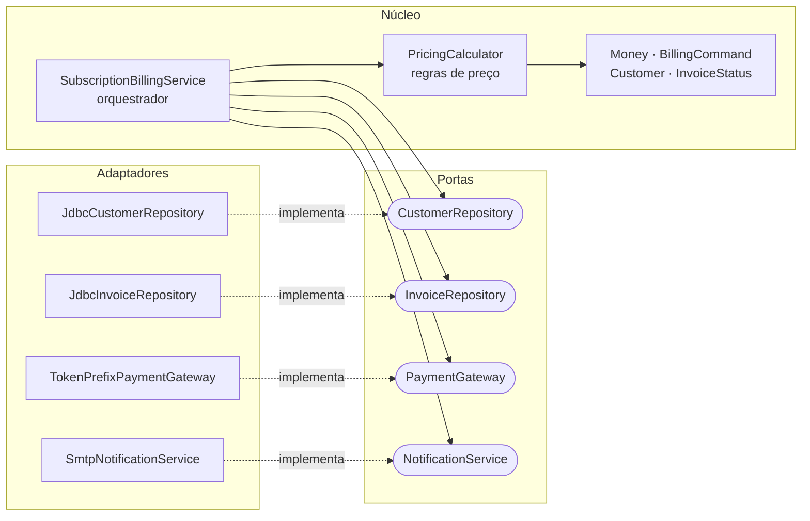

# SaaS Billing Co. - Refatoração do núcleo financeiro

Atividade prática de **Refatoração** da disciplina *Implantação e Entrega de Software* (UFG, Instituto de Informática, 2026/2).

O ponto de partida é um único método legado de 88 linhas que calcula a assinatura, consulta o banco, cobra o cartão, grava a fatura e monta o e-mail, tudo junto. O repositório mostra, commit a commit, como esse método foi desacoplado **sem quebrar o comportamento de negócio** e com uma suíte de testes que roda sem banco e sem SMTP.

| | Antes | Depois |
|---|---|---|
| Método principal | 71 linhas, complexidade ciclomática 18 | 12 linhas, complexidade 2 |
| Parâmetros | 8 soltos (`double`, `String`) | 1 `BillingCommand` |
| Testes | 0 (exigia Postgres e SMTP) | 49, rodam em ~0,2 s |
| Cobertura de linhas | 0% | 85,5% (98,4% fora dos adaptadores JDBC) |

O diagnóstico completo, as métricas e as decisões de comportamento estão no **[RELATORIO.md](RELATORIO.md)**.

## Arquitetura

Arquitetura hexagonal: o domínio e o orquestrador só conhecem **portas** (interfaces). Banco, e-mail e gateway de pagamento entram como **adaptadores**, injetados por fora.



```
src/main/java/com/saas/billing/
├── SubscriptionBillingService.java   # orquestrador (fachada de alto nível)
├── BillingServiceFactory.java        # raiz de composição, lê configuração do ambiente
├── domain/                           # regras puras, sem I/O
│   ├── Money.java                    #   value object imutável, arredondamento em um só lugar
│   ├── BillingCommand.java           #   parameter object da cobrança
│   ├── PricingCalculator.java        #   regras de preço
│   ├── Customer.java
│   └── InvoiceStatus.java
├── port/                             # contratos com o mundo externo
│   ├── CustomerRepository.java
│   ├── InvoiceRepository.java
│   ├── PaymentGateway.java
│   ├── NotificationService.java
│   └── BillingInfrastructureException.java
└── adapter/                          # implementações concretas
    ├── JdbcCustomerRepository.java
    ├── JdbcInvoiceRepository.java
    ├── TokenPrefixPaymentGateway.java
    └── SmtpNotificationService.java
```

## Regras de preço

Aplicadas nesta ordem pelo `PricingCalculator`:

1. **Fidelidade:** mais de 12 meses de casa, 10% de desconto; mais de 24 meses, 15%.
2. **ONG:** 30% de desconto (fator 0,70).
3. **Promoção** (sem diferenciar maiúsculas):
   - `BLACKFRIDAY`: R$ 30,00 de desconto, só em novembro.
   - `WELCOME10`: 10% de desconto, só até 1 mês de casa.
4. **Atraso:** multa de 2% mais juros de 0,1% por dia de atraso.
5. **Piso:** o valor final nunca fica negativo.

A data de referência vem de um `java.time.Clock` injetado, então os cálculos são 100% determinísticos nos testes.

## Como rodar

Requisitos: **Java 21** e **Maven 3.9+**.

```bash
mvn test        # compila e roda os 49 testes; relatório JaCoCo em target/site/jacoco/index.html
```

Nenhum teste precisa de banco de dados, servidor SMTP ou rede.

> No macOS com proxy corporativo que intercepta TLS (por exemplo Cloudflare WARP), o Maven pode falhar com `PKIX path building failed`. Faça o JDK confiar no Keychain do sistema, sem desligar a verificação de certificado:
> `export MAVEN_OPTS="-Djavax.net.ssl.trustStoreType=KeychainStore -Djavax.net.ssl.trustStore=NONE"`

## Uso

```java
SubscriptionBillingService service = BillingServiceFactory.fromEnvironment(System.getenv());

List<String> logs = service.processMonthlyBilling(new BillingCommand(
        "c1", "PRO", Money.of("100.00"), LocalDate.of(2024, 1, 15),
        0, "WELCOME10", false, "tok_abc"));
```

Configuração por variáveis de ambiente (o código-fonte não contém mais credenciais; a fábrica falha logo na partida se faltar alguma obrigatória):

| Variável | Obrigatória | Descrição |
|---|---|---|
| `BILLING_DB_URL` | sim | URL JDBC do Postgres |
| `BILLING_DB_USER` | sim | usuário do banco |
| `BILLING_DB_PASSWORD` | sim | senha do banco |
| `BILLING_SMTP_HOST` | sim | servidor SMTP |
| `BILLING_SMTP_FROM` | sim | remetente dos recibos |
| `BILLING_SMTP_PORT` | não | porta SMTP, padrão 587 |

## Histórico da refatoração

Cada commit é um passo verificável, com a suíte verde ao final.

| Commit | O que muda |
|---|---|
| `3dfd8dd` | Código legado original, sem alteração |
| `46420d3` | Value Objects `Money` e `BillingCommand`, fim da Primitive Obsession |
| `cec4dc9` | Portas e adaptadores, `Clock` injetado, credenciais fora do código, 42 testes |
| `9225dfe` | `PricingCalculator`, orquestrador enxuto, `catch` específico, prova de paridade com a fórmula legada |
| `da1a84e` | Identificação do autor no relatório |

Para ver o legado: `git show 3dfd8dd:src/main/java/com/saas/billing/SubscriptionBillingService.java`

## Garantia de comportamento

Como o legado não roda sem Postgres, a equivalência foi provada de duas formas:

- **`LegacyPricingParityTest`** compara o `PricingCalculator` com uma cópia literal da fórmula original em `double` em 8.960 combinações de entrada. O desvio máximo é de R$ 0,0124, causado exclusivamente pelo arredondamento para centavos do `Money`.
- **`SubscriptionBillingServiceTest`** fixa o fluxo completo (cliente inexistente, inativo, pagamento aprovado, recusado, falha de infraestrutura) e 17 cenários de preço.

Pontos em que a refatoração decidiu algo e que merecem atenção (detalhes no [RELATORIO.md](RELATORIO.md#4-decisões-e-desvios-de-comportamento-leia-antes-de-avaliar)):

- Valores agora são arredondados para centavos (`R$ 90.00`, não `R$ 90.0`).
- Só falhas de infraestrutura são capturadas; bugs de programação deixam de ser mascarados como linha de log.
- O envio real do e-mail continua desativado, como no legado.

## Limitações

- Os adaptadores JDBC não têm teste automatizado, porque exigem banco. O caminho natural é um teste de integração com Testcontainers, fora do `mvn test` padrão.
- O gateway de pagamento continua simulado (aceita tokens `tok_*`), como no legado.
